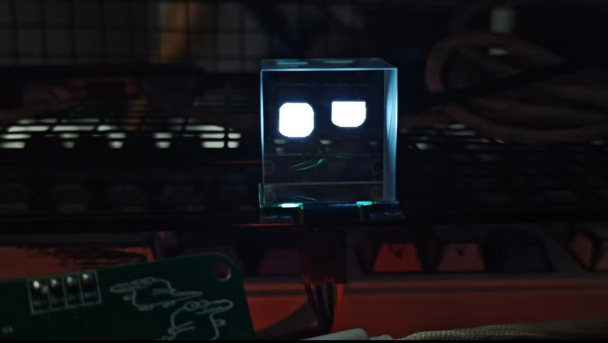
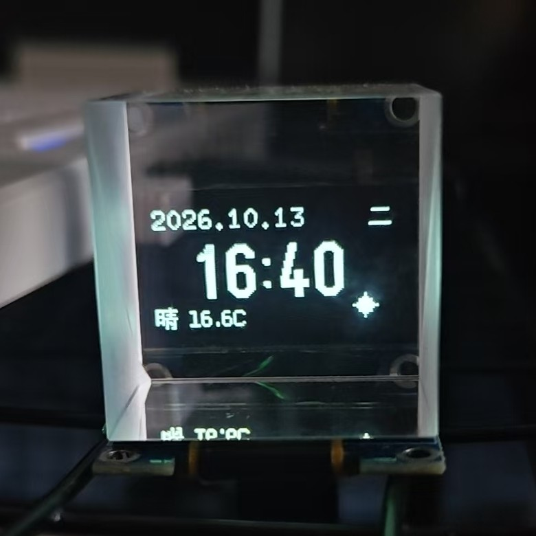

# ESP32 语音交互桌面机器人

> 128×64 OLED 上一只会眨眼、会跟随注视的“眼睛”，听语音指令报时间、日期、星期与天气。
> WiFi、计时、语音、渲染拆成四条 FreeRTOS 任务：动画不因联网卡顿掉帧，断网自动重连，看门狗全程可观测。

**ESP32 / ESP32-C3** · Arduino · FreeRTOS · U8g2 · ArduinoJson · PlatformIO

## 关键指标

| 维度 | 结果 |
| --- | --- |
| 并发 | 4 条 FreeRTOS 任务，优先级 1–4，栈合计 12 KB |
| 显示 | 128×64 单色 OLED；1 KB 整帧缓冲；待机 40 ms/帧调度，信息页 1 Hz |
| 表情 | 18 种参数化表情；600 ms 形变过渡；300 ms 非对称眨眼；500 ms 平滑注视 |
| 语音 | 6 条 UART 指令；115200 8N1；ASCII 行协议；15 s 断流检测 |
| 网络 | 内置多 AP 码表；非阻塞状态机；7 级退避 1 s → 1 h；5 s 连接超时 |
| 健壮性 | 6 s 任务看门狗；时间读取上限 100 ms；实测连续运行 1 个月稳定 |
| 体积 | 固件约 1.1 MB；单槽 2.5 MB 应用分区，占用约 45% |

## 实物

| 待机表情 | 信息页 |
| :---: | :---: |
|  |  |
| 18 种表情随机切换，随机眨眼与注视 | 日期 / 星期 / 时间 / 天气 / 温度一屏显示 |

## 概述

桌面上的语音小机器人：128×64 OLED 上的一双眼睛会眨眼、会跟随注视；对着 ASR Pro 说一句话，它报时间、日期、星期与天气。整套固件跑在 ESP32 / ESP32-C3 上，WiFi、计时、语音、渲染各自独立成任务，互不阻塞。

三条设计原则贯穿整机：

1. **并发隔离。** 网络与 HTTP 的抖动不进入渲染路径，动画始终按 40 ms 节奏推进。
2. **有界阻塞。** WiFi 连接 5 s、HTTP 3 s、时间读取 100 ms，互斥锁持锁时间可控，6 s 看门狗不被误触发。
3. **链路自恢复。** 多 AP 轮换、分级退避、断线重连与重连补校时；断网时表情与本地时钟照常工作。

当前形态为 6 个模块、4 条任务，`ross.ino` 只保留外设与初始化顺序。

## 功能

- **待机表情**：18 种表情随机切换，叠加随机眨眼、随机注视与随机情绪。
- **语音交互**：`WAKEUP` / `TIME` / `DATE` / `WEEK` / `WEATHER` / `SLEEP` 六条指令，查询结果同步回传 ASR 模块播报。
- **信息页**：日期、星期、时间、天气、温度一屏显示，附矢量绘制的晴 / 云 / 雨 / 雪图标。
- **联网能力**：内置多 AP 凭证码表，自动轮换连接；SNTP 校时（UTC+8）；HTTP + JSON 拉取天气。
- **可靠性**：6 s 任务看门狗、断线自动重连、串口 15 s 无数据提示。

## 系统架构

```text
src/ross.ino            组合根：串口、时钟源、初始化顺序
├─ src/app              UI 编排：信息页排版、天气图标、UI 初始化
├─ src/rtos_layer       4 条任务、显示状态机、ASR 协议、HTTP
├─ lib/hal_wifi         WiFi 状态机 + 多 AP 凭证表
├─ lib/oled_u8g2        SSD1306 封装、图元、显示镜像
└─ lib/porting          参数化表情引擎（帧缓冲 + 过渡动画）
```

数据流：

```text
ASR Pro ──UART1 115200──► TaskASR ──► 状态字 / 锁保护数据 ──► TaskOLED ──I2C──► SSD1306
                              │
                              └──HTTP GET──► 天气 API（3 s 超时）──► JSON 解析

TaskWiFi ──状态机──► SNTP 校时 ──► timeinfo ──► TaskClock / TaskASR / UI
```

| 模块 | 关键文件 | 职责 |
| --- | --- | --- |
| 组合根 | [`src/ross.ino`](src/ross.ino) | 串口、`ui_init()` / `rtos_layer_init()` 调用顺序 |
| 应用层 | [`src/app/src/ui.cpp`](src/app/src/ui.cpp) | 信息页排版、天气图标、表情初始化 |
| 任务层 | [`src/rtos_layer/src/rtos_layer.cpp`](src/rtos_layer/src/rtos_layer.cpp) | 任务创建、看门狗、ASR 指令、HTTP、状态切换 |
| 网络 HAL | [`lib/hal_wifi`](lib/hal_wifi/src/wifi_hal.cpp) | 连接状态机、超时判定、AP 轮换、凭证表 |
| 显示驱动 | [`lib/oled_u8g2`](lib/oled_u8g2/src/oled_ssd1306.cpp) | U8g2 封装、越界保护、图元、镜像命令 |
| 表情引擎 | [`lib/porting`](lib/porting/src/eye_expression_port.cpp) | 帧缓冲、12 参数眼睛、过渡/眨眼/注视、随机调度 |

驱动与 HAL 不感知上层业务；业务层通过 `timeinfo`、两把互斥锁与状态字协作，接口边界清晰。

## 核心设计

### 1. 四任务模型：把“等待”移出主循环

| 任务 | 优先级 | 栈（B） | 周期 | 职责 |
| --- | --- | --- | --- | --- |
| `TaskWiFi` | 4 | 4096 | 1 s 轮询 / 5 s 连接超时 | 推进 WiFi 状态机、AP 轮换、退避 |
| `TaskClock` | 3 | 2048 | 1 s | 锁内刷新 `timeinfo` |
| `TaskASR` | 2 | 4096 | 10 ms 轮询 | 解析指令、回传数据、按需拉取天气 |
| `TaskOLED` | 1 | 2048 | 40 ms / 1 s | 表情动画或信息页渲染 |

任务间只共享三样东西：

- `CurrentState`：单写者（`TaskASR`）、单读者（`TaskOLED`），枚举读写天然原子，不加锁。
- `timeinfo`：`TimeMutex` 保护，锁内只做结构体拷贝。
- 天气字符串：`WeatherMutex` 保护，HTTP 与 JSON 解析全部放在锁外。

6 s 任务看门狗下，时钟、语音、渲染三条任务按周期喂狗；任何一条卡死都会触发 panic 重启，而不是静默挂起。

时间读取统一带 100 ms 上限：`getLocalTime(&timeinfo, 100)` 在 `TimeMutex` 内调用，单次持锁不超过 100 ms，为看门狗留出充足余量。整机实测连续运行 1 个月稳定。

### 2. WiFi：内置多 AP 码表 + 非阻塞状态机

```text
IDLE ──connect()──► CONNECTING ──5 s 内连上──► CONNECTED
  ▲                     │ 超时
  │                     ▼
  └──── reset() ────── FAILED
```

- 固件内置 3 组 SSID / 密码码表，上电后按表自动逐项尝试，连上即停；断线后从当前项重连。
- 连接由 `wifi_hal` 状态机推进：`IDLE → CONNECTING → CONNECTED / FAILED`，5 s 超时，任务只轮询状态、不原地等待。
- 整圈 AP 都失败后进入退避：1 s → 10 s → 30 s → 1 min → 10 min → 30 min → 1 h（封顶）。
- 退避延时拆成 500 ms 分片，期间照常喂狗、响应链路变化。
- 每次新连接触发一次 NTP 校时（UTC+8）；断链清除标志，重连后重新校准。
- 效果：换实验室、回家都不需要重烧固件；最坏 1 h 重试一次，断网期间表情与本地时钟不受影响。

### 3. 渲染：整帧缓冲 + 参数化表情

- 硬件 I2C + U8g2 全帧缓冲，一帧一次 `sendBuffer()`，避免逐图元写屏的撕裂与总线开销。
- 表情引擎维护独立的 1024 B page-format 帧缓冲（`idx = (y >> 3) * 128 + x`），自绘水平线、矩形、扫描线三角形与中点椭圆角，最后整块 `memcpy` 进 U8g2 缓冲区统一提交。
- 眼睛抽象为 12 个参数（宽高、上下斜率、上下圆角、偏移等），18 种情绪映射到 18 组左右眼预设（部分带变体）；切换时 600 ms 线性插值，避免硬跳变。
- 眨眼 300 ms，按 30% 闭合 / 5% 保持 / 65% 睁开的非对称曲线；注视用 500 ms smoothstep 插值；眨眼、注视、随机情绪各自独立调度（5–12 s）。
- 左右眼通过参数镜像复用同一套绘制代码（`OffsetX` 与斜率取反）。
- 用 `0xA1` / `0xC0` 段重映射与 COM 扫描方向命令适配实际装配方向。

### 4. 语音：UART 行协议

- UART1，115200 8N1，GPIO16/17；`readStringUntil('\n')` + `trim()` 按行解析。
- 指令与回传格式见[语音指令](#语音指令)；回传为 ASCII 逗号分隔，ASR 侧可直接按字段朗读。
- 天气文本在 MCU 侧归一化为 0–4 编码（晴/云/雨/阴/雪），语音模块不需要理解中文。
- 15 s 未收到任何字节时打印一次接线提示，把“没反应”变成可定位的问题。

### 5. 分区：2.5 MB 单槽应用空间

- 自定义 [`partitions.csv`](partitions.csv) 把 `app0` 扩到 2.5 MB（并入原 OTA 预留槽），NVS / SPIFFS / coredump 布局不变。
- 当前固件约 1.1 MB，占用约 45%，一半空间留给字库、图片与音频。
- 该文件保持纯 ASCII：PlatformIO 会按系统默认编码（中文 Windows 下为 GBK）解析分区表。

## 硬件与接线

| 模块 | 型号 | 接口 |
| --- | --- | --- |
| 主控 | ESP32 DevKit（`esp32dev`）或 ESP32-C3 DevKitM-1 | — |
| 语音 | ASR Pro | UART 115200 8N1 |
| 显示 | SSD1306 OLED 128×64 | I2C |

| OLED | ESP32 | ESP32-C3 |
| --- | --- | --- |
| VCC | 3V3 | 3V3 |
| GND | GND | GND |
| SDA | GPIO21 | GPIO8 |
| SCL | GPIO22 | GPIO9 |

| ASR Pro | ESP32 / ESP32-C3 |
| --- | --- |
| TX | GPIO16（MCU RX） |
| RX | GPIO17（MCU TX） |
| GND | GND（必须共地） |

ASR 模块须使用 3.3 V 电平，5 V 串口模块需加电平转换。

## 构建与运行

仓库内 WiFi 码表为占位符，首次烧录前先在 [`lib/hal_wifi/src/wifi_data.cpp`](lib/hal_wifi/src/wifi_data.cpp) 填写真实 SSID / 密码。

```bash
pio run -t upload
pio device monitor -b 115200
```

默认配置为 `board = esp32dev`。使用 ESP32-C3 时切换板型并打开 USB CDC：

```ini
board = esp32-c3-devkitm-1
build_flags =
    -D ARDUINO_USB_MODE=1
    -D ARDUINO_USB_CDC_ON_BOOT=1
```

经典 ESP32 没有原生 USB 外设，**不能**定义上面两个宏，否则 Arduino 核心会隐藏全局 `Serial`，编译报 `'Serial' was not declared`。

## 语音指令

| 指令 | 动作 | 回传 |
| --- | --- | --- |
| `WAKEUP` | 切到信息页并刷新天气 | — |
| `TIME` | 显示时间 | `HH,MM,` |
| `WEATHER` | 显示天气与温度 | `类型,温度,`（0 晴 / 1 云 / 2 雨 / 3 阴 / 4 雪） |
| `DATE` | 显示日期 | `YY,MM,DD,` |
| `WEEK` | 显示星期 | `0–6` |
| `SLEEP` | 回到表情待机页 | — |

指令必须以 `\n` 结尾。没有语音模块时，可用 USB-TTL 接 GPIO16/17 直接发送；USB `Serial` 仅用于调试输出。

## 目录结构

```text
.
├── src/
│   ├── ross.ino                      # 组合根：串口、初始化顺序
│   ├── app/src/ui.{h,cpp}            # 信息页、天气图标、UI 初始化
│   └── rtos_layer/src/               # 4 条任务、状态机、ASR 协议、HTTP
├── lib/
│   ├── hal_wifi/src/                 # WiFi HAL 状态机 + 多 AP 凭证表
│   ├── oled_u8g2/src/                # SSD1306 封装、图元、镜像
│   └── porting/src/                  # 参数化表情引擎
├── docs/images/                      # 实物与信息页照片
├── partitions.csv                    # 2.5 MB 应用分区
└── platformio.ini
```

## 后续规划

- **配网与持久化**：把内置码表迁到 NVS，支持 AP 配网与运行时增删。
- **OTA 升级**：在 2.5 MB 应用空间基础上规划 A/B 双槽。
- **红外遥控**：码表与对外接口已完成设计，计划接回发射层。
- **天气增强**：城市可配置、结果缓存与多源容错。

## 致谢

- 表情绘制算法移植改编自 GitHub 开源项目 `eye_all_in_one_esp32`：上游基于 U8g2 图元逐笔绘制，本项目改写为原生帧缓冲操作并接入 FreeRTOS 任务。
- 显示与 JSON 分别依赖 [U8g2](https://github.com/olikraus/u8g2) 与 [ArduinoJson](https://github.com/bblanchon/ArduinoJson)，运行于 [Arduino-ESP32](https://github.com/espressif/arduino-esp32)。
